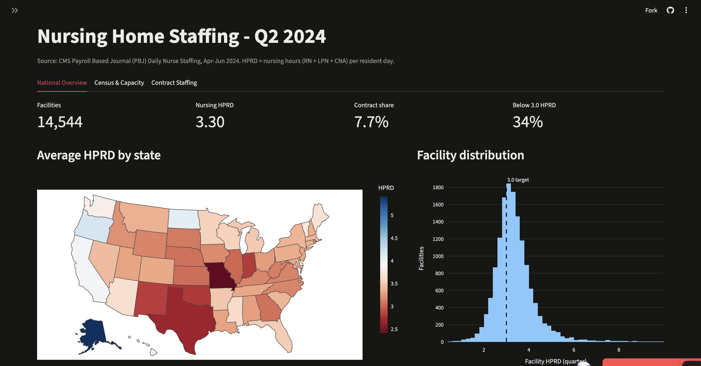

# Nursing Home Staffing Dashboard (Q2 2024)

An interactive dashboard of nurse staffing at 14,500+ U.S. nursing homes, built from CMS payroll data, showing where residents get the least nursing care and how much facilities rely on agency staff.

**🔗 Live dashboard: [clipboard-health-staffing.streamlit.app](https://clipboard-health-staffing.streamlit.app/)**



## Problem
Nursing homes report every hour their nurses work to the Centers for Medicare & Medicaid Services (CMS). This project turns that data into answers operations leaders care about: Which states and facilities are understaffed? Does staffing keep up with how many residents a facility serves? How much do facilities depend on contract (agency) nurses, and what could reducing that save?

## Data
- **Source:** [CMS Payroll Based Journal (PBJ) Daily Nurse Staffing](https://data.cms.gov/quality-of-care/payroll-based-journal-daily-nurse-staffing), Q2 2024 (April 1 to June 30)
- **Size:** 1,325,324 daily records covering 14,564 facilities in 52 states and territories
- **Key fields:** resident census (`MDScensus`) and daily hours for RNs, LPNs and CNAs, split into employed vs. contract staff

## Approach
1. **Load and clean (Python, Google Colab).** Removed days with zero residents and capped Director of Nursing hours at 24 per day. The full exploratory analysis is in [`Clipboard_Health.ipynb`](Clipboard_Health.ipynb).
2. **Aggregate.** [`prepare_data.py`](prepare_data.py) reduces 1.3M daily rows to one row per facility (`data/facilities.csv`) and one row per state per day (`data/daily_state.csv`), so the app loads in seconds.
3. **Visualize (Streamlit + Plotly).** Three tabs, all driven by sidebar filters for state and facility size:
   - **National Overview:** KPI cards, a state map, the facility distribution and a daily trend
   - **Census & Capacity:** staffing vs. facility size, the largest and smallest facilities, and a low-staffing watchlist
   - **Contract Staffing:** agency reliance by state, its link to staffing levels, and a what-if savings calculator

### Key metric: HPRD
**Nursing hours per resident day (HPRD)** = (RN + LPN + CNA hours) ÷ resident days. It's calculated as total hours over total resident-days, not an average of daily ratios, so large and small facilities are weighted correctly. The dashboard uses 3.0 HPRD as an analysis reference line, not a regulatory standard.

### Data quality decisions
- **Excel row limit.** The first version of the analysis loaded an `.xlsx` export, which silently stopped at Excel's 1,048,575-row maximum. Because the file is sorted by state, Texas, Virginia, Washington, Wisconsin and four other states were missing entirely. Switching to the source CSV restored all 1,325,324 rows.
- **Reporting gaps.** 20 facilities report less than 0.5 HPRD for the entire quarter. That's almost certainly missing payroll data, not real staffing, so they're excluded by default (a sidebar checkbox includes them).

## Tech stack
Python · pandas · Plotly · Streamlit · Google Colab · Streamlit Community Cloud · GitHub

## Key results
- **National staffing averages 3.30 HPRD, but 34% of facilities fall below 3.0** for the quarter.
- **The lowest-staffed states are Missouri (2.42), Texas (2.68), Oklahoma (2.80) and Indiana (2.82).** Texas stands out for scale, with 1,167 facilities and 77% of them below 3.0.
- **The highest-staffed states are Alaska (5.41), Oregon (4.19) and North Dakota (4.08)** (states with 10+ facilities).
- **Facility size barely predicts staffing** (r = −0.12 between census and HPRD). The smallest quarter of facilities averages the most care per resident (3.52 HPRD).
- **Contract staff provide 7.7% of nursing hours nationally, and 44% of facilities use none.** Vermont relies on them most, at 32% of nursing hours, followed by Maine (18%) and New Hampshire (17%).
- **Contract use is only weakly linked to higher staffing** (r = 0.21 across states, 0.02 across facilities), so agency staffing alone doesn't explain which states staff well.
- **361 facilities had 10+ days below 1.5 HPRD**, a watchlist for follow-up.

## How to run
```bash
git clone https://github.com/jlredding/Clipboard_Health_Dashboard.git
cd Clipboard_Health_Dashboard
pip install -r requirements.txt
streamlit run app.py
```
To rebuild the data files, download the Q2 2024 CSV from CMS and run `prepare_data.py` (written for Google Colab; update the file path at the top).

## What I learned / next steps
- **Validate row counts against the source.** An Excel export quietly dropped 21% of the data, including eight states. I now check row and category counts after every load.
- **Correlation needs context.** Census and *total* hours correlate at r = 0.91, but that mostly reflects facility size. Comparing per-resident staffing (HPRD) against size is the fairer test, and it shows almost no relationship.
- **Next steps:** add CMS star ratings to connect staffing with quality outcomes, compare against prior quarters, and load the pipeline into Snowflake for scheduled refreshes.

## Contact
[LinkedIn](https://www.linkedin.com/in/jonathan-r-705136b9) · [Email](mailto:jonathan_redding@yahoo.com)
